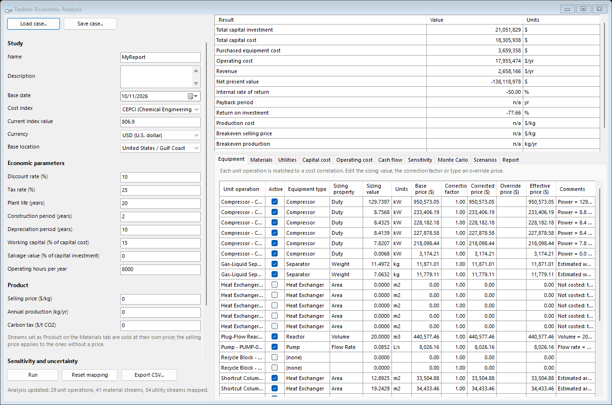
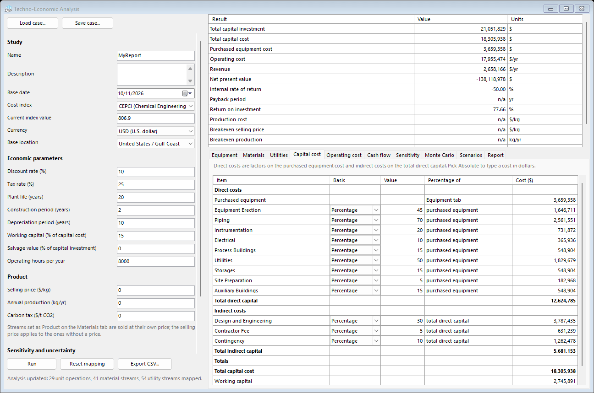
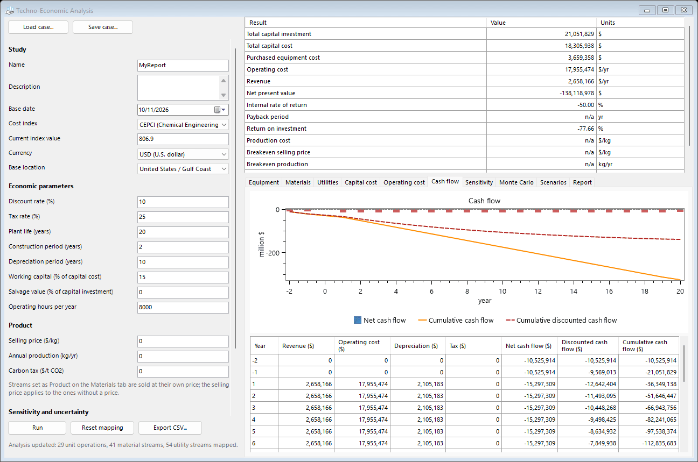
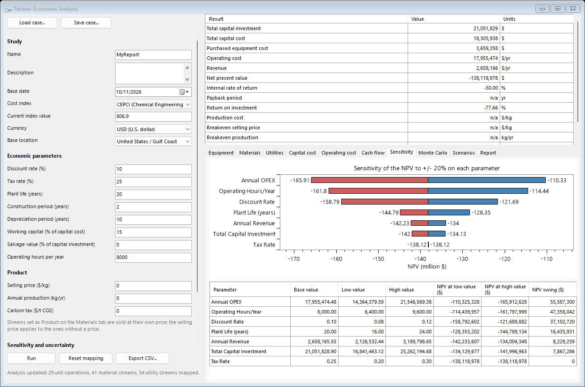
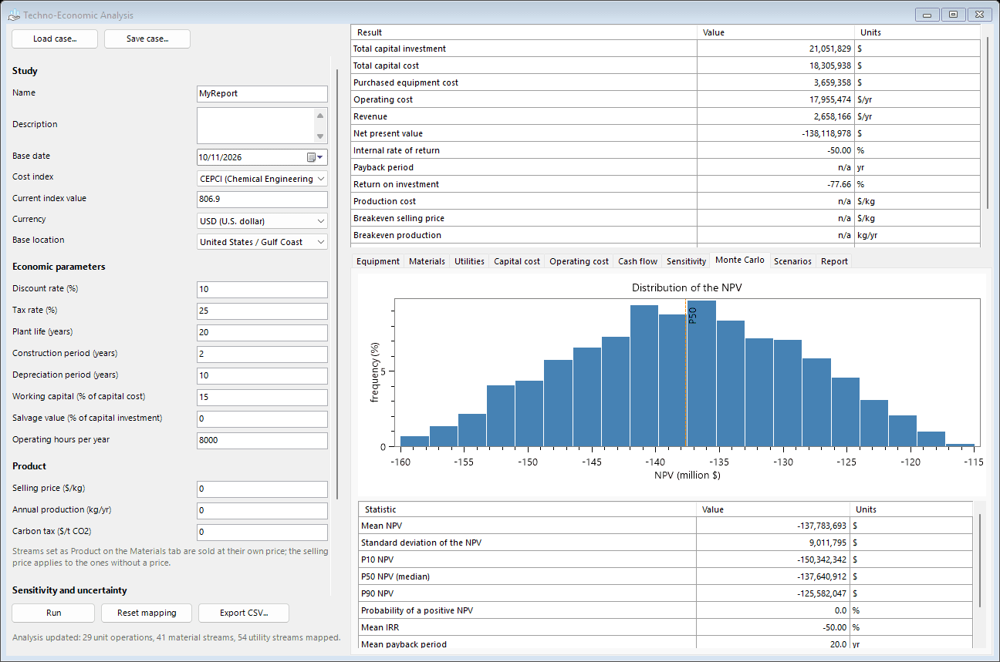
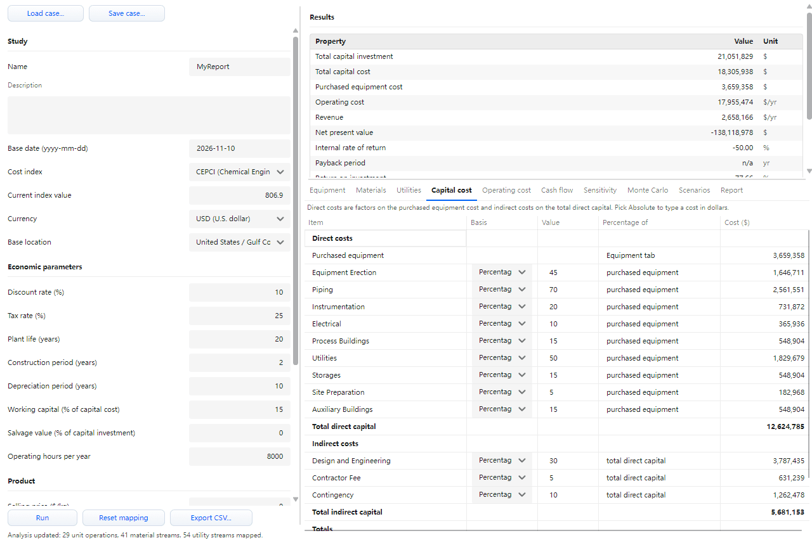

# Techno-Economic Analysis (TEA)

#### Overview

The **Techno-Economic Analysis** (TEA) extension provides plant-wide economic evaluation directly within the DWSIM simulation environment. It estimates capital costs (CAPEX) and operating costs (OPEX) for all unit operations in a flowsheet, then performs discounted cash-flow (DCF) analysis to compute key profitability metrics: net present value (NPV), internal rate of return (IRR), payback period, and return on investment (ROI).

The equipment costing engine implements the correlation-based methodology of Towler & Sinnott  with Chemical Engineering Plant Cost Index (CEPCI) scaling . The correlation database contains over 150 entries spanning compressors, heat exchangers, pumps, vessels, columns, reactors, and filters.

#### Equipment Cost Correlations {#sec:tea_correlations}

Each unit operation is matched to a published cost correlation of the form :

\[
C_{\mathrm{p}}^{0} = a + b\,S^{n}\tag{1}
\]

where $C_{\mathrm{p}}^{0}$ is the purchased equipment cost (in a reference year), $S$ is the capacity or size parameter, and $a$, $b$, $n$ are correlation-specific constants.

##### Capacity Parameter Extraction

The capacity parameter $S$ is extracted automatically from the converged DWSIM unit operation properties:

For heaters and coolers without a directly available area, the heat transfer area is estimated from the duty:

\[
A = \frac{|\Delta Q|}{U \, \Delta T}
\]

using a default overall heat transfer coefficient $U = 0.3$ kW/(m$^2$ K).

##### Cost Index Correction

Equipment costs are escalated from the correlation base year to the current year using the CEPCI :

\[
C_{\mathrm{p}} = C_{\mathrm{p}}^{0} \times
    \frac{\mathrm{CEPCI}_{\mathrm{current}}}{\mathrm{CEPCI}_{\mathrm{base}}}\tag{2}
\]

The default base index is $\mathrm{CEPCI}_{2010} = 550.8$. Location factors and material-of-construction correction factors may be applied multiplicatively .

##### Equipment Cost Override

Each equipment item supports an optional *Override Price*. When set, the override bypasses the correlation-based cost entirely:

\[
C_{\mathrm{effective}} =
  \begin{cases}
    C_{\mathrm{override}} & \text{if override is set,}\\
    C_{\mathrm{base}} \times f_{\mathrm{correction}} & \text{otherwise.}
  \end{cases}\tag{3}
\]

This is useful when vendor quotes or catalogue prices are available for specific equipment. All downstream calculations (CAPEX, cash flow, NPV) use the effective price.

##### Multi-Item Equipment {#sec:tea_multiitem}

Some unit operations contain multiple cost-relevant pieces of equipment. Rather than lumping them into a single cost entry, the extension decomposes them into separate rows in the Equipment Mapping grid, each with its own sizing parameter and correlation.

###### Distillation and absorption columns

All column types (distillation, absorption, refluxed absorber, reboiled absorber, shortcut column) are split into up to three equipment items:

| **Item**  | **$S$ Parameter** | **Unit** | **Correlation** |
|:----------|:--------------------|:---------|:----------------|
| Shell     | Shell weight        | kg       | Separator       |
| Condenser | Estimated area      | m$^2$  | Heat Exchanger  |
| Reboiler  | Estimated area      | m$^2$  | Heat Exchanger  |

Condenser and reboiler areas are estimated from the converged duty using typical overall heat transfer coefficients ($U \cdot \Delta T \approx 15$ kW/m$^2$ for condensers, $\approx 10$ kW/m$^2$ for reboilers). The user should refine these values in the Equipment Mapping grid based on detailed design calculations. Items with zero or negligible duty are omitted automatically.

###### Air cooler

The air cooler is split into two items:

| **Item** | **$S$ Parameter** | **Unit** | **Correlation** |
|:---------|:--------------------|:---------|:----------------|
| Cooler   | Heat load           | kW       | Air Cooler      |
| Fan      | Electrical power    | kW       | Compressor      |

In the Equipment Mapping grid, multi-item equipment rows are labelled with a suffix in parentheses, e.g., “Distillation Column – DC-001 (Shell)”, “Distillation Column – DC-001 (Condenser)”.

##### Refinery Operations {#sec:tea_refinery}

The 11 shortcut refinery unit operations from the *Refining Unit Operations* package are costed using the following correlations and size parameters:

###### Catalytic fixed-bed reactors

Hydrodesulfurizer (HDS), Hydrocracker (HCR), Catalytic Reformer, Isomerization, and Alkylation are costed against the *Reactor* correlation with the reactor volume estimated from the space velocity :

\[
V_{\mathrm{reactor}} = \frac{\dot V_{\mathrm{feed}}}{\mathrm{LHSV}}\tag{4}
\]

where $\dot V_{\mathrm{feed}}$ is the inlet volumetric flow (m$^3$/h) and LHSV is the liquid hourly space velocity (1/h) taken from the unit’s configuration. A default of 1 m$^3$ is used if $\dot V_{\mathrm{feed}}$ or LHSV are unavailable.

###### Throughput-scaled large reactors

The FCC and Delayed Coker are costed against the *Reactor* correlation using feed mass throughput (kg/h) as the capacity parameter, consistent with industrial scaling for riser and drum sizing.

###### Amine treater and shortcut CDU

These column-type units are costed against the *Separator* correlation using an estimated shell weight (kg). For the amine absorber, column volume is sized from the inlet volumetric flow assuming a 2-minute residence time; shell weight is then computed as $\sim$<!-- -->2 % steel by volume ($\rho_{\mathrm{steel}} = 7850$ kg/m$^3$). For the Shortcut CDU, shell weight is approximated as $W \approx 2 \times \dot m_{\mathrm{crude,kg/h}}$, reflecting typical industrial CDU scaling data.

###### Claus sulfur recovery unit

Costed against the *Reactor* correlation with sulfur production rate (tonne/day) as the capacity parameter, consistent with SRU vendor quotes that correlate with elemental sulfur throughput.

###### Product blender

Costed against the *Tank* correlation (with *Separator* fallback) using total blended mass throughput. The blender has the lowest capital intensity of the refinery operations as it contains only piping, valves, and a surge tank.

##### Bio Operations {#sec:tea_bio}

The five bio/biotech unit operations (BioReactor, Anaerobic Digester, Biomass Pretreatment, Cell Lysis, Biogas Upgrader) are detected by class name and dispatched to a dedicated bio cost handler. This bypasses the `ObjectType` switch because the bio ops inherit from the generic `Reactor` or `UnitOpBaseClass` without a dedicated `ObjectType` enum value.

###### BioReactor

Costed against the *Reactor* correlation using the *working volume* (m$^3$) as the capacity parameter for all operation modes (Continuous CSTR, Batch, Fed-batch). The operation mode and kinetic model (Monod, Contois, Moser, Haldane, UserScript, EnzymaticHydrolysis) are captured in the cost-report comments but do not change the base correlation. Adjust the material-of-construction factor for 316L or pharmaceutical-grade cGMP construction.

###### Anaerobic Digester

Costed against the *Reactor* correlation using the vessel volume (m$^3$). The model type (BlackBox, ADM1Lite, ADM1Full) is captured in the comments. The capital intensity is typically lower than an aerobic bioreactor because no impeller sparger, oxygen supply, or sterilization system is required; users may apply a 0.6–0.8 correction factor for agricultural/wastewater digester tankage.

###### Biomass Pretreatment

Costed against the *Reactor* correlation using the reactor volume (m$^3$). The pretreatment technology (DiluteAcid, SteamExplosion, Alkaline, Organosolv) is captured in the comments. Users should adjust the material correction factor for acid-resistant alloys (Hastelloy, duplex stainless) used in aggressive chemical pretreatment.

###### Cell Lysis

The mechanical modes (HighPressureHomogenizer, BeadMill) are costed against the *Compressor* correlation using the feed mass throughput (kg/h); the other modes (Chemical, Enzymatic, Osmotic, Ultrasound) fall back to the *Tank* correlation. Users may refine the correlation match via the correction factor.

###### Biogas Upgrader

Costed against the *Separator* correlation (absorption/separation skid) using the feed mass throughput (kg/h). The technology choice (WaterScrubbing, Amine, PSA, MembraneSeparation) is captured in the comments; material-of-construction factors differ between aqueous-solvent and membrane systems.

###### CFB Fast Pyrolysis

The riser is a vertical cylindrical pressure vessel; the capacity parameter is the riser internal volume computed from the user-supplied diameter and height ($V_\mathrm{riser} = \pi (D/2)^2 H$), matched against the *Reactor* correlation. When the sand-supply mode is `InternalCharCombustor`, the effective volume is multiplied by a factor of $1.3$ to cover the additional char-combustor vessel, cyclone, and downcomer; in `External` mode no scaling is applied and only the riser is costed (the external heater/sand loop is accounted for as an OPEX heating utility in the LCI; see §[Bio operations](20-life-cycle-assessment-lca.md#sec:lca_bio)).

#### Vessel Sizing {#sec:tea_vessel}

For vessels, separators, and distillation columns, the extension sizes the shell using standard two-phase separator design rules :

###### Vertical vessel

The allowable vapour velocity is :

\[
u_{\mathrm{v}} = K \sqrt{\frac{\rho_L - \rho_V}{\rho_V}}\tag{5}
\]

where $K$ is the Souders–Brown constant (default $K = 0.0305$ m/s for vertical vessels). The minimum vessel diameter follows from the vapour volumetric flow:

\[
D = \sqrt{\frac{4\,Q_V}{\pi\,u_{\mathrm{v}}}}
\]

Liquid hold-up time ($t_h = 300$ s default) sets the liquid height:

\[
h_L = \frac{Q_L \times t_h}{\tfrac{1}{4}\pi D^2}
\]

The total vessel height includes vapour disengagement and surge allowances.

###### Horizontal vessel

The procedure follows Arnold  with a liquid-level fraction of 50 % of the diameter.

###### Shell weight

The shell weight is estimated from vessel dimensions, wall thickness (from ASME pressure vessel rules), and steel density ($\rho_{\mathrm{steel}} = 7850$ kg/m$^3$):

\[
W = \rho_{\mathrm{steel}} \left[
    \pi\,D\,t\,L + 2 \times \tfrac{\pi}{4}D^2 \times t
  \right]\tag{6}
\]

where $t$ is the wall thickness and $L$ the tangent-to-tangent length.

#### Capital Cost Estimation {#sec:tea_capex}

The total capital investment (TCI) is built up from the purchased equipment cost using the factorial (Lang) method :

##### Direct Capital

| **Item**                  | **Default % of Equipment Cost** |
|:--------------------------|:-------------------------------:|
| Equipment Erection        |              45 %               |
| Piping                    |              70 %               |
| Instrumentation & Control |              20 %               |
| Electrical                |              12 %               |
| Civil / Structural        |              10 %               |
| Buildings & Structures    |              20 %               |
| Lagging & Painting        |               5 %               |

\[
C_{\mathrm{DC}} = C_{\mathrm{equip}} \left(1 + \sum_{i} f_{i}^{\mathrm{direct}}\right)\tag{7}
\]

##### Indirect Capital

| **Item**             | **Default % of Direct Capital** |
|:---------------------|:-------------------------------:|
| Design & Engineering |              25 %               |
| Contractor’s Fee     |               5 %               |
| Contingency          |              10 %               |

\[
\mathrm{TCI} = C_{\mathrm{DC}} \left(1 + \sum_{j} f_{j}^{\mathrm{indirect}}\right) + C_{\mathrm{WC}}\tag{8}
\]

where $C_{\mathrm{WC}}$ is the working capital (default 15 % of TCI).

All CAPEX factor percentages and absolute/percentage modes are editable on the Capital cost tab.

#### Operating Cost Estimation {#sec:tea_opex}

Annual operating costs are divided into fixed, variable, and miscellaneous categories :

###### Fixed costs

Labour, maintenance (default 6 % of CAPEX), insurance (1.5 %), plant overhead, and capital charges (depreciation + interest).

###### Variable costs

Raw material costs (from feed stream mass flows and user-specified prices), utility costs (electricity, steam, cooling water, from energy-stream duties), and waste disposal.

###### Total operating cost

\[
C_{\mathrm{OPEX}} = C_{\mathrm{fixed}} + C_{\mathrm{variable}} + C_{\mathrm{misc}}\tag{9}
\]

#### Cash-Flow Analysis {#sec:tea_cashflow}

The extension performs year-by-year discounted cash-flow analysis over the plant life .

##### Net Present Value

The annual net cash flow in operating year $k$ is:

\[
\mathrm{NCF}_k = (R - C_{\mathrm{OPEX}} - D)(1 - t) + D\tag{10}
\]

where $R$ is annual revenue, $D$ is annual depreciation (straight-line), and $t$ is the corporate tax rate. During the construction period, cash flows are negative fractions of TCI.

The NPV is:

\[
\mathrm{NPV} = \sum_{k=0}^{N} \frac{\mathrm{NCF}_k}{(1 + r)^k}\tag{11}
\]

where $r$ is the discount rate and $N$ is the total project life including construction.

##### Internal Rate of Return

The IRR is the discount rate $r^{*}$ that sets $\mathrm{NPV} = 0$:

\[
\mathrm{NPV}(r^{*}) = 0\tag{12}
\]

##### Payback Period

The payback period is the smallest year $k$ for which the cumulative undiscounted cash flow turns positive:

\[
\mathrm{PBP} = \min\left\{k : \sum_{i=0}^{k} \mathrm{NCF}_i \geq 0 \right\}\tag{13}
\]

##### Return on Investment

\[
\mathrm{ROI} = \frac{\overline{\mathrm{NCF}}}{\mathrm{TCI}}\tag{14}
\]

where $\overline{\mathrm{NCF}}$ is the average annual net cash flow during the operating period.

#### Production Cost

The cost of production per unit of product is:

\[
c_{\mathrm{prod}} = \frac{C_{\mathrm{OPEX}} + C_{\mathrm{capital\,charge}}}{m_{\mathrm{product}}}\tag{15}
\]

where $m_{\mathrm{product}}$ is the annual production mass (kg/year) and $C_{\mathrm{capital\,charge}}$ includes annualised CAPEX (capital recovery factor $\times$ TCI).

#### Breakeven Analysis {#sec:tea_breakeven}

The breakeven analysis determines three critical thresholds at which NPV = 0:

1.  **Breakeven selling price**: minimum product price (\$/kg) for the project to break even over the plant life.

2.  **Breakeven production rate**: minimum annual production (kg/year) at the current selling price.

3.  **Breakeven CAPEX**: maximum total capital investment (TCI) that the project can sustain and still achieve NPV $\geq$ 0.

Each threshold is found by bisection on the NPV function with 100 iterations.

#### Sensitivity Analysis {#sec:tea_sensitivity}

The one-at-a-time sensitivity analysis varies each of seven key parameters by the sensitivity range (default $\pm 20\%$) from its base value and records the resulting NPV. The parameters analysed are:

- Total Capital Investment (TCI)

- Annual Revenue

- Annual OPEX

- Discount Rate

- Tax Rate

- Plant Life (years)

- Operating Hours per Year

Results are sorted in descending order of NPV swing ($|\text{NPV}_{\mathrm{high}} - \text{NPV}_{\mathrm{low}}|$) and drawn as a tornado chart, the largest swing on top.

#### Monte Carlo Uncertainty Analysis {#sec:tea_montecarlo}

The Monte Carlo analysis performs a set number of stochastic iterations of the DCF analysis (default 1000). Each iteration independently samples TCI, annual revenue, and annual OPEX from symmetric triangular distributions whose bounds are the Monte Carlo spread around the base-case value (default $\pm 15\%$; the base case is the mode). The sample count and the spread are set in the left panel of the window. The outputs are:

- Mean and standard deviation of NPV

- P10, P50 (median), and P90 percentiles

- Probability of positive NPV (%)

- Mean IRR and mean payback period

- NPV frequency distribution histogram (20 bins)

#### Scenario Comparison {#sec:tea_scenarios}

Users can save the current analysis result as a named scenario. Multiple scenarios are displayed in a comparison grid with columns for equipment cost, CAPEX, TCI, OPEX, revenue, NPV, IRR, payback, ROI, and production cost. This facilitates rapid comparison of design alternatives, parameter variations, or process configurations.

#### Eco-Efficiency Index {#sec:tea_ecoeff}

When both TEA and LCA have been run, the eco-efficiency index combines economic performance (production cost per kg) with environmental impact (GWP per kg):

\[
\text{EEI} = \frac{1}{c_{\mathrm{prod}} \times \text{GWP}_{\mathrm{per\,kg}}}
  \quad [\text{kg}/(\$ \cdot \text{kgCO}_2\text{eq})]\tag{16}
\]

Higher values indicate better eco-efficiency. This metric is displayed in the results summary of the TEA window and requires LCA to have been run previously.

#### User Interface {#sec:tea_ui}

The plant-wide TEA is launched from the **Flowsheet Analysis** menu of the flowsheet window in the Classic interface, and from the **Tools** menu in the Cross-Platform interface, under **Techno-Economic Analysis $\rightarrow$ Plant-Wide Techno-Economic Analysis**. The window has the same layout in both interfaces and in the other DWSIM study tools, such as the vessel depressurization tool (Figure [1](#fig:tea_window)):

- **Left panel**: the inputs of the study. **Load case...** and **Save case...** on top; then the study data (name, description, base date, cost index CEPCI or IPC and its current value, currency and base location), the economic parameters (discount rate, tax rate, plant life, construction and depreciation periods, working capital, salvage value, operating hours), the product (selling price, annual production, carbon tax) and the settings of the sensitivity and Monte Carlo analyses; **Run**, **Reset mapping** and **Export CSV...** at the bottom, over a status line.

- **Right panel**: the results summary on top (capital investment, capital and equipment cost, operating cost, revenue, NPV, IRR, payback, ROI, production cost, the three breakeven values, the probability of a positive NPV and, after an LCA, the GWP per kg and the eco-efficiency index) and, under a splitter, the tabs listed below.

**Run** maps the flowsheet and calculates everything. After the first run, an edit on any table of the right panel is applied at once: capital and operating costs, cash flow, charts, summary and report follow it. **Run** keeps the prices, overrides, material and utility choices and comments typed on the mapping tabs, and reads flow rates and sizes again; **Reset mapping** discards those edits and maps the flowsheet again from the price databases.

*Figure 1: The Techno-Economic Analysis window of the Classic interface, on the methanol synthesis sample: inputs on the left, results summary and Equipment tab on the right.*

The tabs of the right panel are:

- **Equipment**: all unit operations with matched correlations. Each row shows the equipment type, the sizing property, an editable sizing value, units, the computed base price, an editable correction factor, the corrected price, an optional override price (a fixed price that bypasses the correlation) and the effective price. **Active** takes a unit out of the estimate. Multi-item equipment (columns, air coolers) produces separate rows for each sub-item (see §[Multi-Item Equipment](#sec:tea_multiitem)).

- **Materials**: feed and product streams with mass flows and annual costs. Each row includes the material type (Raw Material or Product), the material selected from the cost database, the main compound, the unit price per kilogram and an editable correction factor. A typed price is taken as current money, so the cost index is not applied to it.

- **Utilities**: energy streams (priced per kJ) and material streams billed as utilities (priced per kg), with utility type, unit price, annual cost and correction factor. Material rows are inactive by default.

- **Capital cost** and **Operating cost**: the cost items of §[Capital Cost Estimation](#sec:tea_capex) and §[Operating Cost Estimation](#sec:tea_opex). Each factor is a percentage or an absolute value (column **Basis**); the column **Percentage of** names its base, and the totals follow every edit.

- **Cash flow**: year-by-year discounted cash-flow table and a chart of the net cash flow of each year with the cumulative and the cumulative discounted cash flow (Figure [3](#fig:tea_cashflow)).

- **Sensitivity**: the results of §[Sensitivity Analysis](#sec:tea_sensitivity) as a table and as a tornado chart (Figure [4](#fig:tea_tornado)).

- **Monte Carlo**: the statistics of §[Monte Carlo Uncertainty Analysis](#sec:tea_montecarlo) and the NPV histogram, with the zero NPV and the median marked (Figure [5](#fig:tea_mc)).

- **Scenarios**: **Save current results** keeps the main results under a name, to compare design alternatives side by side (§[Scenario Comparison](#sec:tea_scenarios)).

- **Report**: the whole analysis as one document (indicators, equipment costs, materials, utilities, CAPEX/OPEX breakdown, cash-flow table, sensitivity, Monte Carlo summary and scenarios), regenerated after every change. **Copy report** puts it on the clipboard as Markdown.

*Figure 2: The Capital cost tab: cost factors, their bases and the resulting costs.*

*Figure 3: The Cash flow tab.*

*Figure 4: The tornado chart of the Sensitivity tab.*

*Figure 5: The NPV distribution on the Monte Carlo tab.*

##### Case Files

The study (setup, economic parameters, cost factors and every edit on the mapping tabs) is stored in the flowsheet and saved with it. When the window is opened on a flowsheet that carries a study, the analysis runs by itself. **Save case...** and **Load case...** write and read the same study as a `.dwtea` file, which carries it from one flowsheet to another.

##### AI-Assisted Analysis

The “Analyze with AI” button on the Report tab sends the full report to the DWSIM AI assistant, which provides expert insights on economic viability, cost drivers, sensitivity, optimisation opportunities, benchmarking, and risk assessment. The AI response is streamed in real time and appended to the report.

##### CSV Export

The “Export CSV...” button exports the complete analysis to a semicolon-separated file: summary, equipment costs (including override and effective prices), raw materials and products, utilities, capital and operating cost items, cash-flow table, sensitivity and Monte Carlo results.

##### Cross-Platform Interface

The Cross-Platform interface has the same window, inputs, tabs and charts (Figure [6](#fig:tea_av)). Its Report tab shows the report as Markdown text.

*Figure 6: The Techno-Economic Analysis window of the Cross-Platform interface.*

#### ExtraProperties Keys

Per-equipment results are stored in each unit operation’s `ExtraProperties` with the following keys (where `{Tag}` is the unit operation’s graphical tag):

| **Key**                    | **Description**                         |
|:---------------------------|:----------------------------------------|
| `TEA_{Tag}_Price_USD`      | CEPCI-corrected purchased cost (USD)    |
| `TEA_{Tag}_BasePrice_USD`  | Base-year purchased cost (USD)          |
| `TEA_{Tag}_EquipmentType`  | Matched correlation name                |
| `TEA_{Tag}_CapacityParam`  | Extracted capacity value                |
| `TEA_{Tag}_CapacityUnit`   | Capacity unit (kW, m$^2$, kg, etc.)   |
| `TEA_{Tag}_MarkdownReport` | Per-equipment cost breakdown (Markdown) |

###### Plant-wide results

When the plant-wide analysis or API is run, the following keys are stored in the *flowsheet-level* `ExtraProperties`:

#### Programmatic API {#sec:tea_api}

The `TEAApi` static class provides a programmatic interface for running a complete techno-economic analysis from code (e.g., IronPython scripts, automation workflows, or external applications).

##### Basic Usage

    using DWSIM.Extensions.TechnoEconomicAnalysis;

    // Run TEA with default settings
    TEAApiResult result = TEAApi.Analyze(flowsheet);

    // Access key indicators
    double npv = result.NPVUSD;
    double irr = result.IRR;
    double payback = result.PaybackPeriodYears;
    double roi = result.ROI;
    double costPerKg = result.ProductionCostPerKg;

    // Access CAPEX/OPEX
    double capex = result.TotalCapitalInvestmentUSD;
    double opex = result.AnnualOperatingCostsUSD;
    double revenue = result.AnnualRevenueUSD;

    // Get the full Markdown report
    string report = result.MarkdownReport;

##### Custom Settings

    var settings = new TEASettings
    {
        DiscountRate = 0.10,
        PlantLifeYears = 25,
        TaxRate = 0.25,
        OperatingHoursPerYear = 8000
    };
    TEAApiResult result = TEAApi.Analyze(flowsheet, settings);

##### Result Structure

The `TEAApiResult` class contains:

- **Key indicators**: `NPVUSD`, `IRR`, `PaybackPeriodYears`, `ROI`, `ProductionCostPerKg`, `ProductionCostPerTonne`.

- **CAPEX breakdown**: `TotalEquipmentCostUSD`, `TotalDirectCapitalUSD`, `TotalIndirectCapitalUSD`, `TotalCapitalCostUSD`, `WorkingCapitalUSD`, `TotalCapitalInvestmentUSD`.

- **OPEX breakdown**: `AnnualFixedCostsUSD`, `AnnualVariableCostsUSD`, `AnnualMiscCostsUSD`, `AnnualOperatingCostsUSD`, `AnnualRevenueUSD`.

- **Detailed lists**: `Equipment`, `Materials`, `Utilities`, `CashFlow`.

- **Report**: `MarkdownReport`, the complete analysis in Markdown format.

The API automatically stores all results in the flowsheet’s `ExtraProperties` (see table above), making them accessible to other extensions, scripts, and the DWSIM AI assistant.

