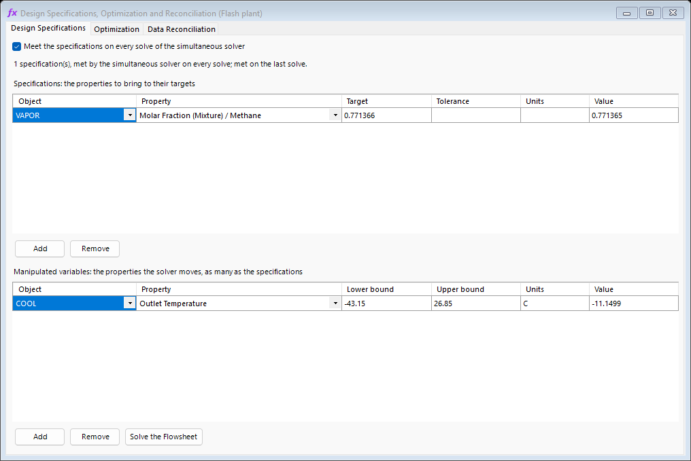
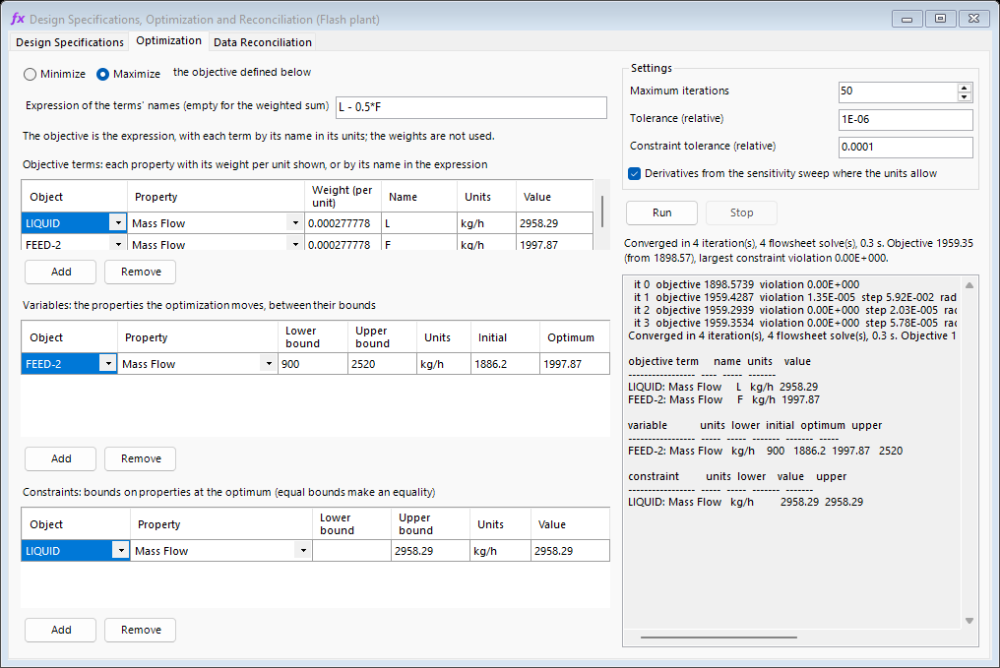
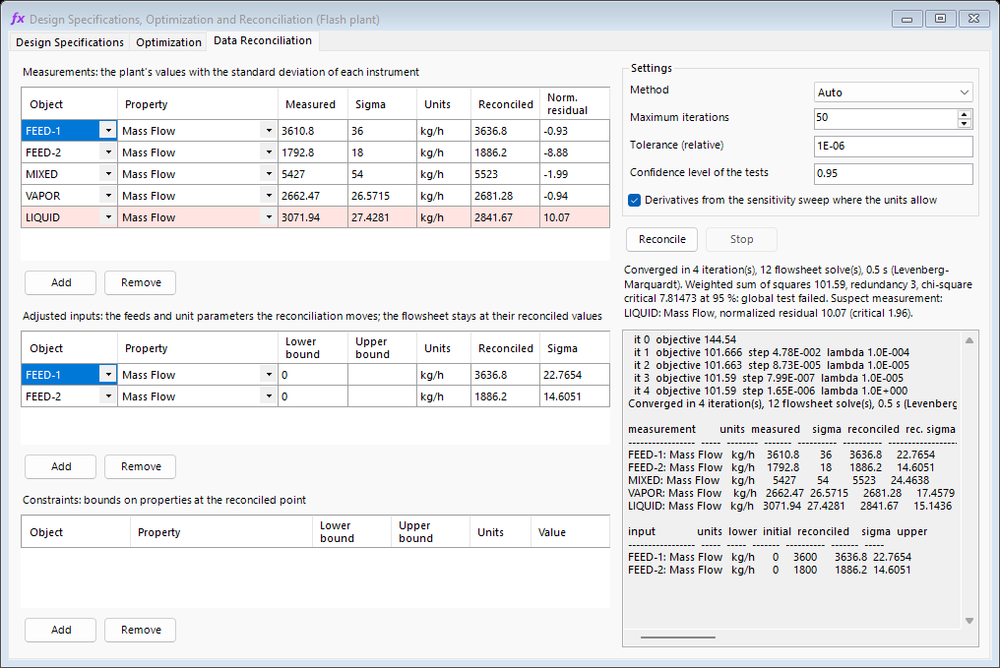

# Simultaneous Flowsheet Solver

#### Overview {#overview-51}

The sequential-modular solver converges a flowsheet one block at a time: each Recycle iterates on its own torn stream (by successive substitution, Wegstein or Broyden acceleration), and each Adjust runs its own loop, nested inside the recycle loops that surround it. On flowsheets where several recycles share compounds, or where an adjust acts on a variable inside a recycle, the nested loops interact and can take many passes or fail to converge.

The **Simultaneous Flowsheet Solver** (Patreon Edition) converges every Recycle, Energy Recycle and Adjust of the flowsheet at once. The unit operations are calculated exactly as before, by their own models; only the outer iteration changes.

#### Selecting the solver strategy

The strategy is a property of the flowsheet and is saved with it:

| **Interface** | **Where** |
|:---|:---|
| Classic (Windows) | `Solver:` button on the flowsheet toolbar, next to the simultaneous adjust button |
| Cross-platform | `Solver > Solver Strategy` menu |

###### Sequential-Modular

The default, and the strategy every file saved with an earlier version opens with. Recycles and adjusts are converged by their own blocks.

###### Simultaneous

Every steady-state solve of the flowsheet is handed to the simultaneous solver.

###### Auto

The simultaneous solver takes the flowsheet when it has already solved it once (it keeps the solution of the previous solve, see below) or when an Adjust acts inside a recycle, where the sequential solver nests its loops; otherwise the sequential solver runs.

Without a Patreon membership the log says so and the sequential solver runs. Dynamic simulations are always solved sequentially, one pass per time step.

#### Method

##### Unknowns and equations

The unknowns $\mathbf{x}$ are the state of every torn stream (temperature, pressure and the mass flow of each compound), every recycled energy flow and every manipulated variable of an Adjust. A torn stream that DWSIM calculates from its pressure and enthalpy takes its mass enthalpy in place of the temperature: a temperature written into it would be ignored, and in two phases it does not fix the state. These are the streams of a single compound, and every stream of a property package that treats its mixtures as one fluid (the CoolProp incompressible mixtures, a lithium bromide solution among them). The function $\mathbf{g}(\mathbf{x})$ is one sequential pass of the flowsheet with the recycle and adjust blocks taken out: the solver writes $\mathbf{x}$ into the torn streams and the manipulated variables, the unit operations are calculated in the usual order, and the pass returns the recalculated torn streams and the controlled variables. The residuals are

\[
\mathbf{r}(\mathbf{x}) =
\begin{bmatrix}
\mathbf{g}_{\mathrm{tear}}(\mathbf{x}) - \mathbf{x}_{\mathrm{tear}} \\
y_{\mathrm{adjust}}(\mathbf{x}) - y_{\mathrm{target}}
\end{bmatrix} = \mathbf{0}\tag{1}
\]

and a recycle or adjust counts as converged with the tolerances set in its own block, by the same rules the block applies.

##### Newton iteration

The system is solved by a damped Newton method,

\[
\mathbf{J}\,\Delta\mathbf{x} = -\mathbf{r}(\mathbf{x}_k), \qquad
\mathbf{x}_{k+1} = \mathbf{x}_k + \lambda\,\Delta\mathbf{x}\tag{2}
\]

with a backtracking line search on $\lambda$, limits on the change of each variable in one step, and flows kept non-negative. The first matrix is minus the identity for the torn variables, so the first step is a plain successive-substitution step, plus one finite-difference column for each adjust. Broyden updates then shape the matrix from the passes the iteration makes anyway. A full finite-difference Jacobian is built only when the line search fails with the updated matrix, or when the matrix is singular, which happens when the controlled variable of an adjust lies upstream of its manipulated variable across a torn stream (the minus-identity columns carry no derivative of it). Its columns are evaluated in parallel on copies of the flowsheet held in memory; with a CAPE-OPEN unit operation in the loop they are evaluated one after the other on the flowsheet itself, since the component answers one call at a time and a copy of it fails its first solve. When the Jacobian has to be built again in the same solve, the columns that move disjoint sets of residuals in the first one are perturbed together, one pass per group.

##### Warm start

The solution, and the Jacobian when one was built, are saved with the flowsheet. The next solve, in the same session or after the file is opened again, starts from them, and a small change of a feed usually converges in one or two iterations. If the current point cannot be evaluated (a unit operation fails), the solver tries the saved solution, then points halfway and a quarter of the way toward it.

##### Confirmation

When the solve converges, the solver reads the torn streams back from the flowsheet and runs one more pass. An answer that does not close on that pass (a unit operation that carries a state from one pass to the next) is solved again from there, and handed to the sequential solver if it still does not close.

##### When the solve does not converge

###### Restart

A solve that started from the substitution matrix and stops at the noise floor (below) starts again from the same point with a finite-difference Jacobian. The two starts take different paths, and the noise of a column can stop one of them short of the tolerances and not the other. When the restart does not close either, the flowsheet goes back to the first answer.

###### Fallback

A solve that does not converge is handed to the sequential solver, and the log says so.

###### Noise floor

Columns and other unit operations that iterate internally return results with a small noise. When the line search stops making progress, after a finite-difference Jacobian has been built, with every error within ten times its tolerance, the solver stops at the best point, without handing the flowsheet to the sequential solver, and the log says how many times the tolerance was left; loosen the recycle or adjust tolerances, or tighten the convergence tolerances of the columns. A matrix shaped by Broyden updates from the substitution start that stops making progress is replaced by a finite-difference Jacobian first.

###### Specifications without a steady state

When the finite-difference Jacobian is close to singular (condition number above $10^{8}$), the specifications may fix no steady state, or many (a closed loop whose inventory nothing sets). The log says so and names the recycle or adjust variables along the singular direction, which are the ones to check.

#### Messages

A converged solve writes a line to the log with the number of Newton iterations, the passes on the flowsheet, the Jacobian columns built (if any), whether it started warm, and the time taken. Unconverged solves give a warning with the reason and what to change.

#### Performance

The number of passes depends on how strongly the recycles interact. With tight tolerances (0.01 K, 0.1 Pa and $10^{-4}$ kg/s on every recycle):

| **Case** | **Sequential** | **Simultaneous** |
|:---|---:|---:|
| Cavett problem, torn flows halved and 10 K hotter | 25 passes | 11 passes |
| Biodiesel production (adjust inside a recycle), feeds $\times$ 1.2 | not converged | 8 passes |

On 59 flowsheets from the samples and the case library, solved as saved and again after a change of the feeds, both solvers closed every recycle and adjust and agreed within the tolerances; the one exception was a flowsheet close to having no steady state, where both stopped at different points inside the tolerance. On flowsheets with a single, loosely coupled recycle the sequential solver is as fast.

#### Limitations

- Spec blocks set to run after the flowsheet are not repeated inside each pass; Spec blocks attached to an object are.

- Recycles and adjusts marked as dynamic-only stay out of the steady-state system, as in the sequential solver.

- An adjust whose manipulated variable does not affect its controlled variable at steady state makes the system singular, and neither solver closes it.

- A tolerance below the noise of the unit operations that iterate internally is not reached by either solver.

- With a CAPE-OPEN unit operation (a ChemSep column) in a loop, the Jacobian is built one column at a time, and a solve can stop a few times above the tolerances, at the resolution of the column's own convergence.

#### Design Specifications, Optimization and Data Reconciliation

With the simultaneous solver, the converged flowsheet is a model that can be solved for targets, optimized and fitted to plant data (Patreon Edition). The three problems are set up in one window, **Design Specifications, Optimization and Reconciliation**, opened from the `Flowsheet Analysis` menu in the classic interface and from the `Tools` menu in the cross-platform one. Each row of its tables picks an object and one of its properties from lists; the numbers are typed and shown in the units of the flowsheet. The problem, with the results of its last run, is saved with the file.

The figures below come from a flash plant: two hydrocarbon feeds mixed, cooled and separated into vapor and liquid.

##### Design specifications

*Figure 1: Design specifications: the methane mole fraction of the vapor brought to its target by the outlet temperature of the cooler.*

A design specification asks for a property to reach a target; the solver reaches it by moving the properties listed under **Manipulated variables**, within their bounds, as many of them as there are specifications (Figure [1](#fig:simultaneous_specifications)). It does the work of an Adjust block without the block: every specification adds the equation

\[
y_{\mathrm{spec}}(\mathbf{x}) - y_{\mathrm{target}} = 0\tag{3}
\]

to the residuals of Equation [1](#eq:simultaneous_residuals), and every manipulated variable an unknown, so the specifications are met together, and together with the recycles, instead of one loop inside another. They are paired with the variables as a set; a specification is not tied to one variable.

###### Target and tolerance

The target is in the units shown. An empty tolerance stands for $10^{-6}$ of the target, or of 1 when the target is smaller.

###### When they are met

On every steady-state solve with the solver strategy set to Simultaneous or Auto (Auto takes the simultaneous solver whenever there are active specifications), while **Meet the specifications on every solve of the simultaneous solver** is checked. The line under the check box says whether they are met, and why not when they are not. A solve with specifications that does not converge is reported as failed: the sequential solver knows nothing of them, so the flowsheet is not handed to it. The usual reason is a target out of reach within the bounds of the variables, and the message names the variable held at its bound.

##### Optimization

*Figure 2: Optimization: the liquid product, less half the heavy feed that makes it, maximized by the heavy feed flow, with an upper bound on the liquid.*

The optimization moves feed and unit properties, the **Variables**, within their bounds, to maximize or minimize an objective of the converged flowsheet, with bounds on other properties as **Constraints**:

\[
\max_{\mathbf{u}}\ \mathrm{or}\ \min_{\mathbf{u}}\ f\left(\mathbf{y}(\mathbf{u})\right)
\quad \mathrm{subject\ to} \quad
\mathbf{u}_{L} \le \mathbf{u} \le \mathbf{u}_{U}, \qquad
\mathbf{c}_{L} \le \mathbf{c}(\mathbf{u}) \le \mathbf{c}_{U}\tag{4}
\]

where $\mathbf{y}$ and $\mathbf{c}$ are properties of the flowsheet solved at $\mathbf{u}$, with its recycles closed and its design specifications met. Equal bounds on a constraint make an equality.

###### Objective

Each row of **Objective terms** is a property. With the expression box empty, the objective is the sum of the terms times their weights, a weight being per unit shown. With an expression, each term enters by its **Name**, in the units of its row (the units in which the property was shown when it was picked), and the weights are not used: `50.0*L - 0.02*Q`, `(x - 0.95)^2`, `max(a, b)`. The expression is written in the language of the Spec block. Two of its rules change a number without an error, and the line under the box points them out: a leading minus binds tighter than the power, so `-x^2` is $(-x)^2$ (write `0.0 - x^2`), and two whole numbers divide as whole numbers, so `1/2` is 0 (write `1.0/2.0`). Figure [2](#fig:simultaneous_optimization) maximizes `L - 0.5*F`, the liquid product less half the heavy feed, both in kg/h.

###### Method

Sequential quadratic programming with a trust region. At each point the gradient of the objective and the linearized constraints come from the sensitivities of the unit operations where they allow it, and from finite differences elsewhere; a quadratic model, its curvature built up by BFGS updates, is solved by the interior point method without solving the flowsheet, and the flowsheet is solved once at the step it proposes. A step that does not improve the objective and the constraints together enough is refused and the trust region shrinks.

###### Settings and results

**Maximum iterations**; **Tolerance**, the relative change of the objective below which the optimization stops; **Constraint tolerance**, the relative violation allowed; and whether the derivatives come from the sensitivities. **Run** starts the optimization and **Stop** ends it before its next iteration. The line under the buttons gives the iterations, the flowsheet solves, the time, the objective at the end and at the start, and the largest violation of the constraints; the log lists every term, variable and constraint in the units of the flowsheet. The flowsheet is left at the best point found. A squared objective, such as a deviation from a target, meets the tolerance with only its square root on the deviation itself: tighten the tolerance (to $10^{-10}$, say) to bring the deviation down to $10^{-5}$.

##### Data reconciliation

*Figure 3: Data reconciliation: five mass flows measured with a standard deviation of 1 %, the liquid one 12 standard deviations off, reconciled by moving the two feed flows.*

The reconciliation brings the flowsheet as close to plant measurements as their uncertainties allow. It moves the **Adjusted inputs**, the feeds and unit parameters that are not known exactly, within their bounds, to minimize

\[
\sum_{i} \left( \frac{m_i - y_i(\mathbf{u})}{\sigma_i} \right)^2\tag{5}
\]

where $m_i$ is a measured value, $\sigma_i$ the standard deviation of its instrument and $y_i$ the same property of the converged flowsheet. Since the flowsheet is the model, its mass and energy balances hold at every point visited. **Constraints** bound other properties at the reconciled point.

###### Measurements

Picking a property fills the measured value with the one the flowsheet has, to be replaced by the plant's; the standard deviation, in the units shown, has to be given. After a run, the table shows the reconciled value and the normalized residual of each measurement, and the table of the inputs their reconciled values and standard deviations.

###### Method

**Auto** uses Levenberg-Marquardt without constraints and Gauss-Newton sequential quadratic programming with them; the interior point method can be chosen too. The derivatives come from the sensitivities of the unit operations where they allow it, and from finite differences elsewhere.

###### Tests

The redundancy is the number of measurements less the number of inputs moved (an input that ends on a bound counts as fixed). With redundancy, the global test compares the weighted sum of squares with the chi-square quantile at the confidence level: above it, the measurements do not agree with the model within their standard deviations. The normalized residual of a measurement is its adjustment over its own standard deviation; the largest one above the normal quantile marks the suspect measurement, highlighted in the table. In Figure [3](#fig:simultaneous_reconciliation) the sum of squares is 101.6 against a critical value of 7.81, and the liquid flow is pointed out with a normalized residual of 10.07 against 1.96. With fewer measurements a gross error can be impossible to place: measuring the two feeds, the vapor and the liquid only, the liquid and the heavy feed that makes most of it come out with nearly the same residual.

###### Results

The line under the buttons gives the iterations, the flowsheet solves, the method, the sum of squares, the redundancy, the global test and the suspect measurement; the log lists every measurement and input in the units of the flowsheet. The flowsheet is left at the reconciled inputs.
