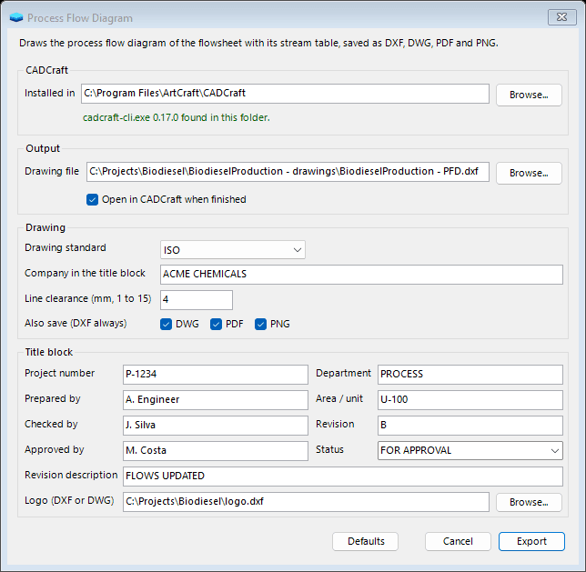
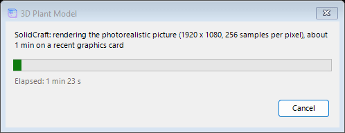

# Overview

The CAD Tools menu of the flowsheet window turns a solved simulation into the documents of a plant design: a 3D model of the plant, built in SolidCraft, and the drawings of the process and of its equipment, drawn in CADCraft. The drawings are the process flow diagram (PFD), the piping and instrumentation diagram (P&ID), a general arrangement drawing of each item of equipment, an isometric of each line, the data sheets and the plot plan. The menu and its dialogs are the same in the Classic and in the Cross-Platform interfaces.

SolidCraft and CADCraft are separate programs that you install on their own; CADCraft also comes in the ArtCraft suite, next to SolidCraft. DWSIM drives their command-line programs, `solidcraft-cli` and `cadcraft-cli`, and links nothing of them, so a tool runs only where its program is installed. DWSIM looks for each program in the folder chosen in a CAD Tools dialog, then in the folder named by the `SOLIDCRAFT_HOME` or `CADCRAFT_HOME` environment variable, then in the usual install folders and on the `PATH`.

|  |  |
|:---|:---|
| **Menu item** | **What it does** |
| **Export 3D Plant Model** | Builds the 3D model of the flowsheet and saves it as a SolidCraft design, a STEP file, pictures, the line list, the material take-off and a web viewer. |
| **Update 3D Plant Model Data** | Sends the operating data of the solved flowsheet to the 3D model without building it again. |
| **Reset 3D Plant Layout** | Forgets the places of the items moved in SolidCraft, so the next model follows the flowsheet drawing again. |
| **Export Process Flow Diagram** | The PFD with its stream table. |
| **Export P&ID** | The P&ID with line numbers, control loops, indicators, relief valves and a legend sheet. |
| **Export Equipment Drawings** | A general arrangement drawing of each vessel, column, tank, exchanger, pump and compressor. |
| **Export Piping Isometrics** | An isometric of each line of the 3D model, with its line data and bill of materials. |
| **Export Data Sheets** | A data sheet for each item of equipment, each control loop and each local indicator. |
| **Export Plot Plan** | The plot plan of the 3D model with the equipment coordinates. |
| **Export All Drawings** | All the drawings above in one run, bound into one drawing set PDF. |

#### The dialog of a tool

Every item of the menu opens a dialog before it runs. The groups it shows depend on the tool:

- **Program:** the folder of SolidCraft or CADCraft that DWSIM found, and the version of its command-line program. Browse picks another folder. A version older than the ones the exports were made with (SolidCraft 0.30, CADCraft 0.17) shows in orange: the tool still runs, but parts of the export may fail.

- **Output:** the output folder, or the DXF file of a drawing of one sheet, and whether to open the result when the tool is done. The choice is saved with the simulation, relative to its folder when it lies inside it, so the next export of the same simulation goes to the same place.

- **Drawing and Title block:** the drawing standard, the files saved and the fields of the title block, described with the drawings below.

- **Items to draw:** for the tools that draw one sheet per item or line, the list to choose from.

- **3D model:** for the isometrics and the plot plan, whether the 3D model changed in SolidCraft since DWSIM last read it.

- **Defaults:** puts the options of the dialog and its output back to their defaults.

*The dialog of the process flow diagram, with the title block filled in.*

#### Files from an earlier export

When an export would replace the files of an earlier one, the first click on Export lists them and turns the button into Replace; the second click runs the tool. A drawing edited in CADCraft or in another CAD program loses those edits when it is replaced, so the dialog offers to keep the old files: tick *Keep the old files* and they move to a folder named Superseded, with the date and time, next to the new ones. The 3D model is left out of this check, because exporting it again is how it is updated and the items moved in SolidCraft are kept.

#### Progress and cancelling

A tool runs in the background, so DWSIM stays free while SolidCraft or CADCraft works. A small window shows the step the tool is on (for the tools that draw many sheets, which sheet of how many) and the time it has taken. Cancel closes SolidCraft or CADCraft at once and ends the tool; what was finished stays in the output folder. When the tool is done, the window says what happened and can open the output folder, and the messages of the flowsheet list the files saved and anything left out. Closing the window leaves the tool running.

*The progress window during a render.*

