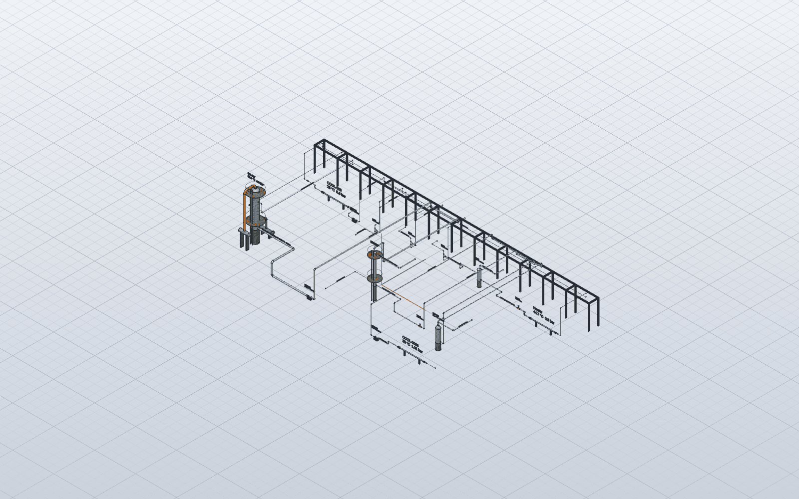
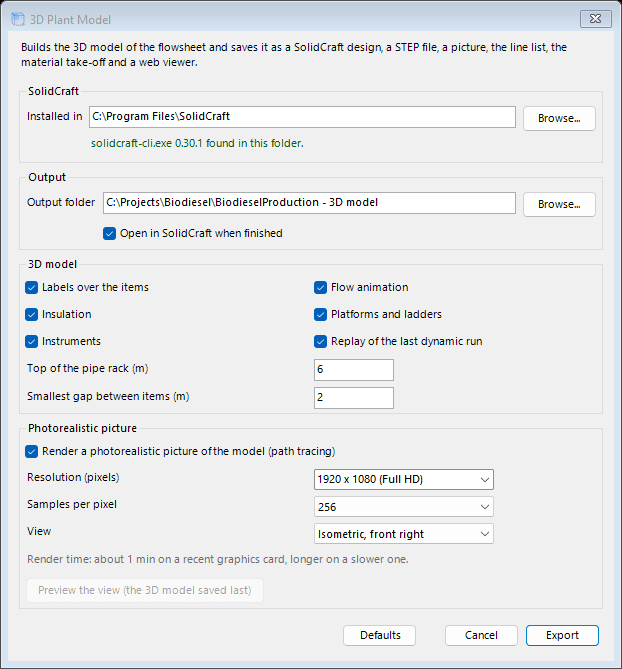
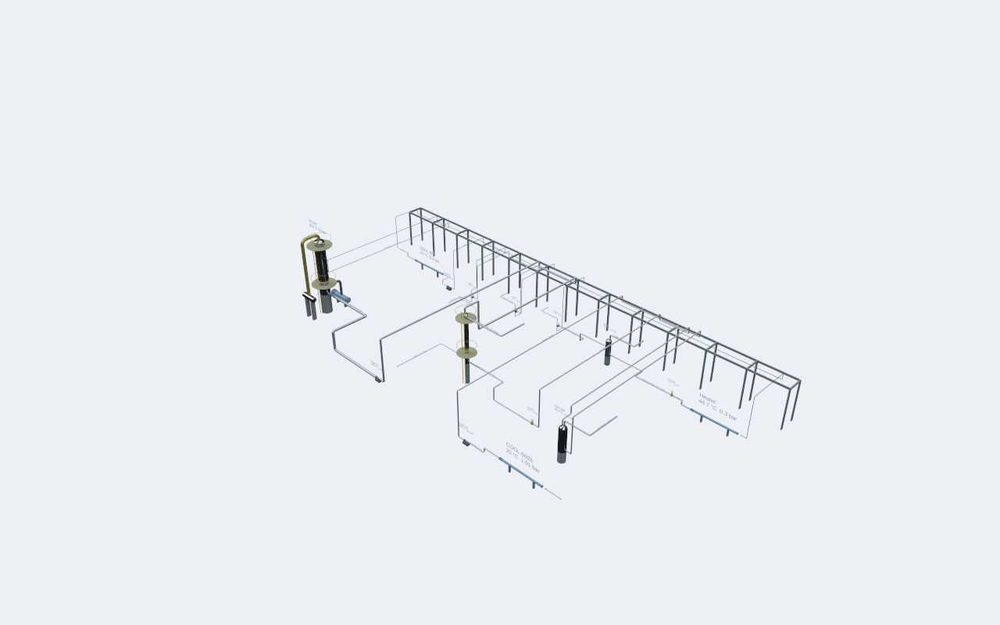

# The 3D Plant Model

#### What it builds

In the file names below, *name* stands for the name of the simulation file. Export 3D Plant Model turns each unit operation into an item of equipment, sized from its own data or, when it has none, estimated from its streams, and places it where its icon is on the flowsheet, scaled so that neighbouring items keep the smallest gap set in the dialog. Each material stream becomes a pipe between the nozzles of the items it connects, routed in straight runs and bends along a pipe rack, and sized as the standard pipe for a typical velocity of its phase: about 2 m/s for a liquid, 10 m/s for a two-phase stream and 20 m/s for a vapor.

|  |  |
|:---|:---|
| **File** | **What it holds** |
| **`name.sc`** | The SolidCraft design: one body per item and per line, with the operating data of each. |
| **`name.step`** | The geometry, for other CAD programs. |
| **`name.png`** | A picture of the model from the isometric view. |
| **`name - render.png`** | The photorealistic picture, when it was asked for. |
| **`name - line list.csv`** | The lines with their size, phase, ends and operating data, in the regional format of the computer. |
| **`name - material take-off.csv`** | The pipe lengths and fittings by size. |
| **`name - 3D viewer.html`** | The model in one web page that opens in any browser: orbit around it, point at an item or a line to read its data, and watch the flow move along the lines. It needs no SolidCraft. |
| **`name - clashes.csv`** | Where a line passes through an item, two lines meet or two items overlap, when the check finds any. |
| **`name - flow.gif`** | The flow animation, when it was asked for. |

The options of the dialog:

- **Labels over the items:** the tag and the main operating data of each item, over it.

- **Flow animation:** bands that slide along the lines, faster where the velocity is higher. In SolidCraft, play the motion study named Flow.

- **Insulation:** a jacket on the lines that run hot or cold.

- **Platforms and ladders:** on the vessels and columns that need them.

- **Instruments:** a transmitter where each controller takes its measurement, a local indicator for each gauge, and control valves on the valves a controller moves.

- **Replay of the last dynamic run:** the monitored variables of the last dynamic run move markers on gauges in the model (a level rises and falls on the front of its vessel). Play the motion study named Dynamic Replay; a GIF is saved as well. The data of a run stay in memory, so run the schedule before exporting.

- **Top of the pipe rack** and **Smallest gap between items:** in the length units of the flowsheet.

Two checks run during the export and report in the messages of the flowsheet. The clash check finds lines that pass through items, lines that meet and items that overlap. The line hydraulics screening estimates the pressure drop along each routed line (Darcy-Weisbach with the Churchill friction factor, bends as equivalent lengths, the static head, a two-phase line taken as homogeneous) and names the lines where it matters: the simulation gives each stream one pressure, so these are the lines that need a proper hydraulic calculation.

*The 3D model of the biodiesel sample in SolidCraft, with labels over the items and the pipe rack.*

#### Moving items in SolidCraft

Items can be moved and turned in SolidCraft. The next export reads where each item went from the design saved last and keeps those places with the simulation (save the simulation to keep them), so a new export never loses an arrangement made by hand. Only quarter turns about the vertical are kept; a tilt is dropped, and both are reported. Reset 3D Plant Layout forgets the places, so the next model follows the flowsheet drawing again; the last design is set aside as `name - before layout reset.sc`.

#### Updating the data

Update 3D Plant Model Data sends the operating data of the solved flowsheet to the model without building it again: to the SolidCraft window when the model is open there, otherwise into the saved design. The line list and the material take-off are written again.

#### The photorealistic picture

With *Render a photorealistic picture* ticked, SolidCraft renders the model by path tracing on the graphics card, in an industrial HDR environment. The dialog sets the picture:

- **Resolution:** one of the presets, or a size typed as width x height, from 320 x 200 up to 7680 x 4320 pixels.

- **Samples per pixel:** more samples give less noise and take longer. 64 is SolidCraft’s own; 16 makes a draft and 4096 a final picture.

- **View:** four isometric views (front right, front left, back left, back right), the front and side elevations, and the plan.

The dialog estimates the render time for the size and samples chosen: about 25 s to load the scene and 0.03 s per million pixel-samples on a recent graphics card, so a Full HD picture at 256 samples takes under a minute and a 4K picture at 4096 samples about 17 minutes. The estimate turns orange above 10 minutes; a slower card takes longer. *Preview the view* renders the chosen view from the 3D model saved last, at 800 x 500 with 16 samples, in about half a minute, and opens the picture.

*The dialog of the 3D plant model.*

*The photorealistic picture of the biodiesel sample, isometric view from the front right.*

