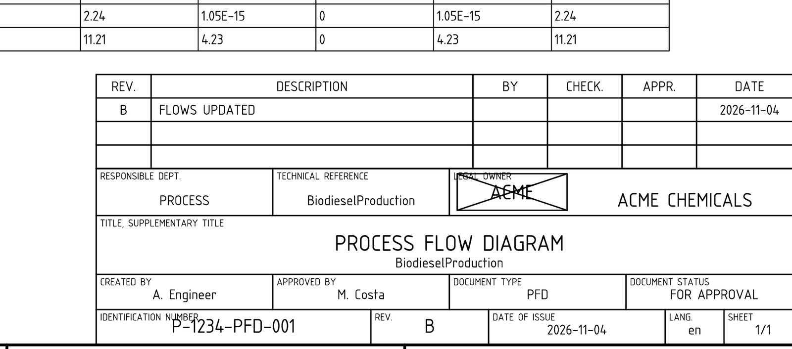
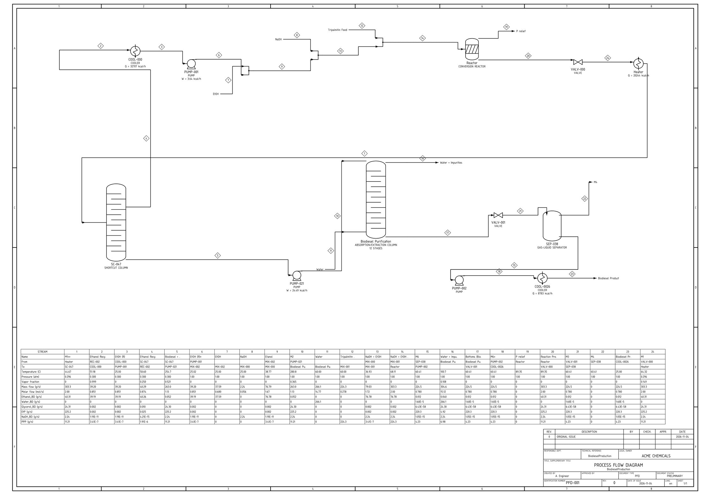
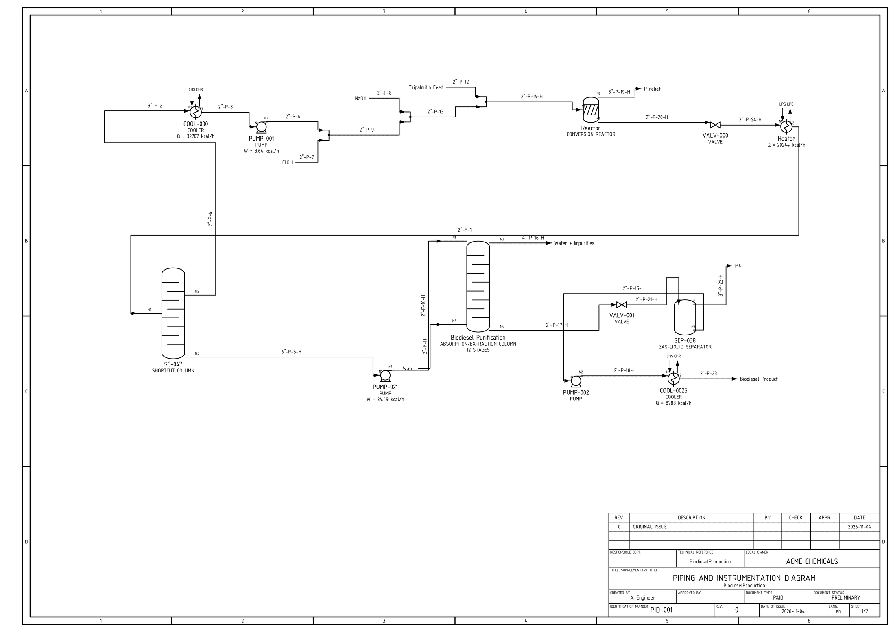
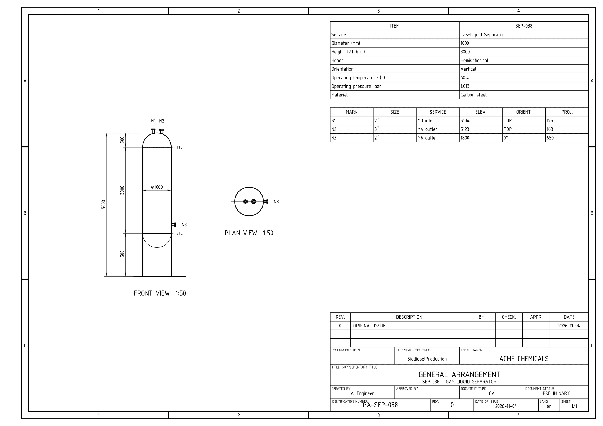
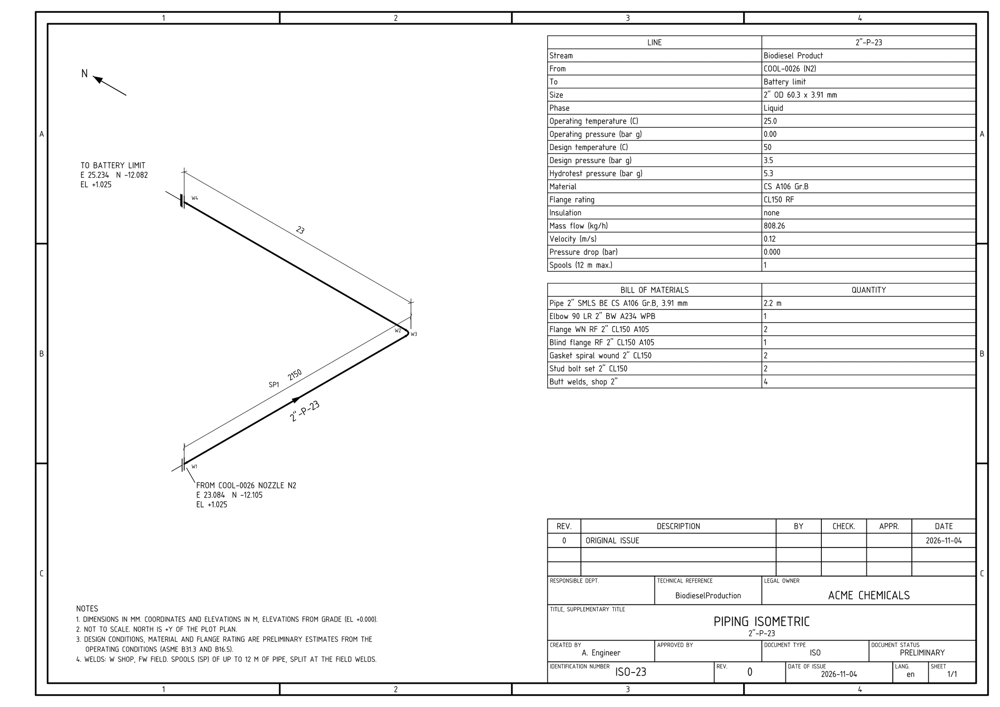
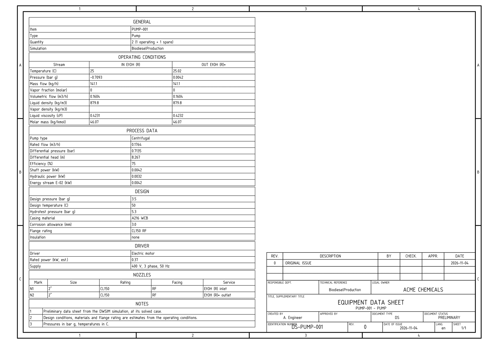
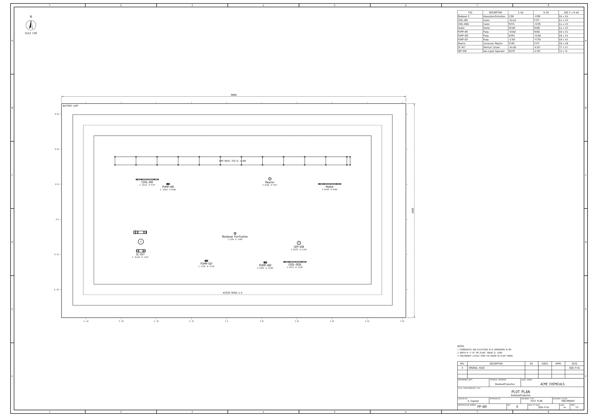
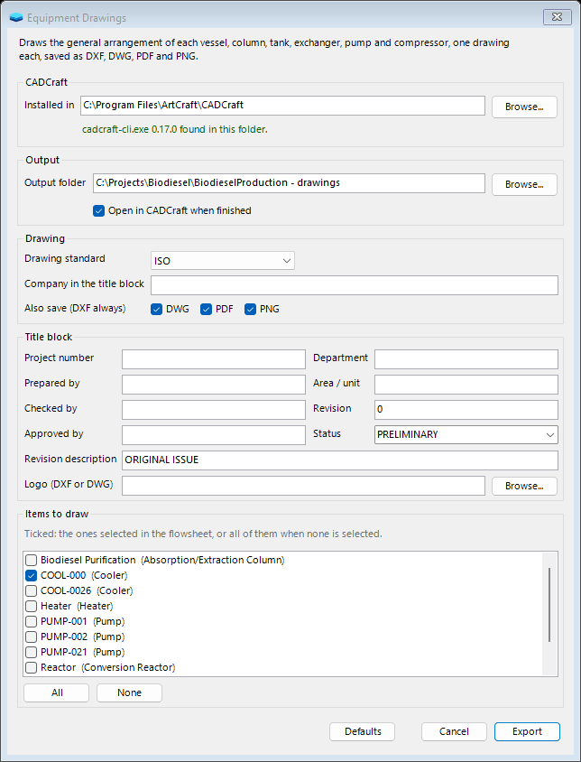
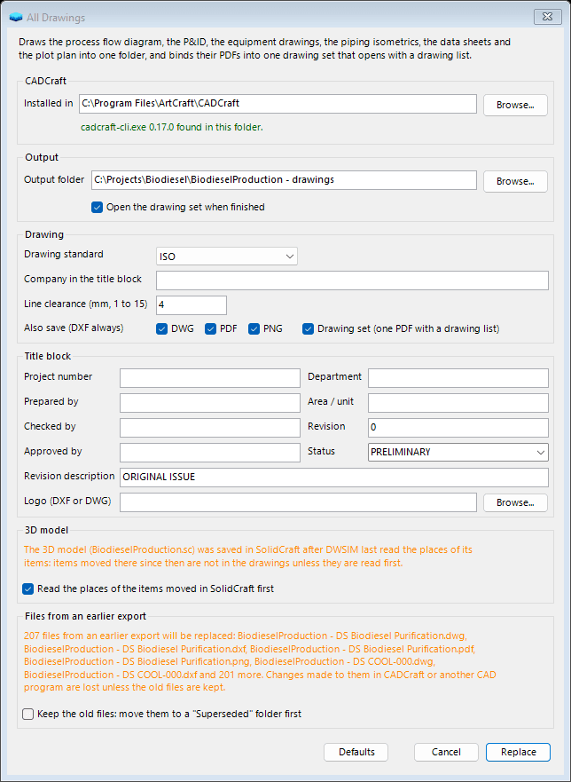
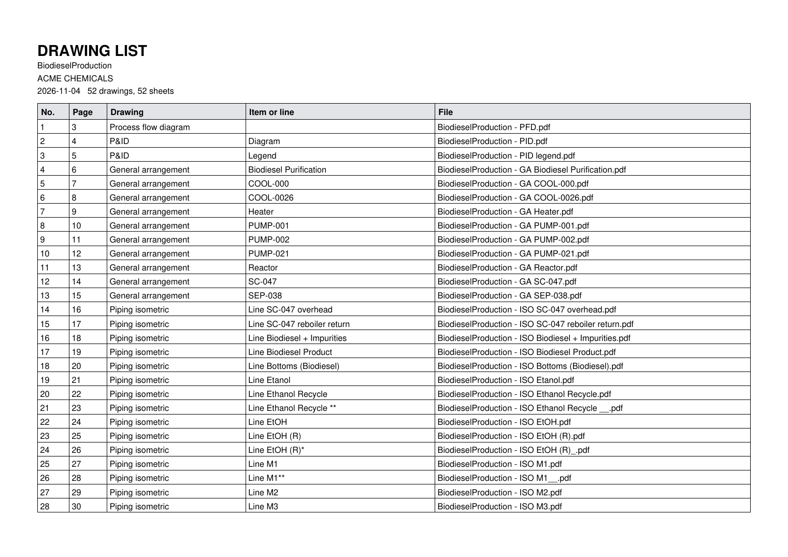

# Drawings with CADCraft

#### Drawing standards and the title block

Every drawing has a sheet with a border, reference zones, a revision table and a title block in one of three standards:

- **ISO:** A-series sheets with the border of ISO 5457 and the title block of ISO 7200.

- **ASME:** ANSI sheets in inches after ASME Y14.1, with approvals and a revision block.

- **Petrobras:** A-series sheets with the legend of N-381 and the document code of N-1710.

The drawings are lettered in osifont, the free ISO 3098 font for CAD. Where it is not installed, CADCraft letters them with its own font and DWSIM saves the font file in the output folder, to install. The title block takes the fields of the dialog:

|  |  |
|:---|:---|
| **Field** | **In the title block** |
| **Company** | The legal owner (client). |
| **Project number** | Put before each document number: P-1234-PFD-001. |
| **Revision and its description** | The revision field and the first line of the revision table. |
| **Status** | Preliminary, for review, for approval, approved, for construction, as built, or any text. |
| **Prepared, checked and approved by** | The people; an empty Prepared by leaves the author of the simulation. |
| **Department and area** | Where the standard has the fields. |
| **Logo** | A DXF or DWG drawing, scaled into the field beside the owner (ISO, ASME) or into the brand field (Petrobras). CADCraft does not place raster pictures yet. |

Each drawing is saved as a DXF file; the DWG, the PDF and the PNG next to it can each be left out. The drawing tools share these choices, kept in the settings.

*An ISO title block filled in from the dialog, with a logo.*

#### Process flow diagram

Each unit operation is drawn as its equipment symbol where its icon is on the flowsheet, and each stream along a route of horizontal and vertical segments that keeps a clearance from the items and from the other lines (the line clearance of the dialog, in mm on the sheet). The streams are numbered, and a stream table gives the conditions, flows and compound flows of every stream in the units of the flowsheet.

*The process flow diagram of the biodiesel sample.*

#### Piping and instrumentation diagram

The P&ID adds what the PFD leaves out: line numbers of the form size, service, number and insulation (2"-P-14-H), the nozzles of the items, the control loops with their transmitters, controllers and control valves, the local indicators, the relief valves and the utility connections. A legend sheet shows the symbols the diagram uses; it is saved as its own PDF and PNG, `name - PID legend`.

*The P&amp;ID of the biodiesel sample.*

#### Equipment drawings

Each vessel, column, tank, exchanger, pump and compressor gets a general arrangement drawing from the geometry of the 3D model: a front view and a plan view at a standard scale, the main dimensions, the nozzles marked N1, N2 and so on with a nozzle schedule, the data of the item from the simulation and its preliminary design conditions. These take the design pressure 10 % above the operating one (at least 1 bar), the design temperature 25 °C above it, the material by temperature and the flange class from the ASME B16.5 ratings.

*The general arrangement of a gas-liquid separator.*

#### Piping isometrics

Each line of the 3D model gets an isometric: its route from nozzle to nozzle, or to the battery limit, in isometric projection and not to scale, with the elbows, flanges and welds (shop and field), the spools of up to 12 m, the true length of every leg, the elevations, the coordinates of the ends, the flow direction and a north arrow. Beside the drawing come the line data (operating and preliminary design conditions, material, flange rating, velocity, pressure drop) and the bill of materials.

*The isometric of the biodiesel product line.*

#### Data sheets

There is a data sheet for each item of equipment (its operating conditions stream by stream, process data, preliminary design conditions and materials, main dimensions and nozzles), for each control loop (transmitter, controller and control valve, with the flow coefficient of the valve) and for each local indicator, in metric engineering units.

*The data sheet of a pump.*

#### Plot plan

The plot plan shows each item in plan where the 3D model places it, with its tag and coordinates, the pipe rack with its bays, the access road round the plant and the battery limit, a coordinate grid, the overall dimensions, a north arrow and the equipment location table, at a standard scale.

*The plot plan of the biodiesel sample.*

#### Choosing what to draw

The equipment drawings, the isometrics and the data sheets list their items, lines or sheets in the dialog. The ones selected on the flowsheet come ticked, or all of them when nothing is selected, so selecting two items and opening Export Equipment Drawings draws those two. A partial export replaces only the sheets of the items chosen.

*Two items of the list ticked, the ones selected on the flowsheet.*

#### The isometrics, the plot plan and the 3D model

The isometrics and the plot plan place the items where the 3D model has them, from the places kept with the simulation. When the design was saved in SolidCraft after DWSIM last read it, items may have moved there since: the dialog says so in orange and offers to read the places first, which needs SolidCraft and takes a few seconds. Exporting the 3D model reads them too.

#### Export All Drawings and the drawing set

Export All Drawings makes the six kinds of drawing in one run, into one folder. A kind that cannot be made (a flowsheet with no lines has no isometrics) is reported and the others go on. With *Drawing set* ticked, the PDFs are bound into one file, `name - drawing set.pdf`, that opens with a drawing list (each drawing, the item or line it shows, the page it starts on and its file) and has a bookmark for each kind of drawing and each sheet. The drawing set needs the PDF files.

*Export All Drawings over an earlier export, with the 3D model saved in SolidCraft since DWSIM last read it.*

*The first page of the drawing list of the biodiesel sample.*

