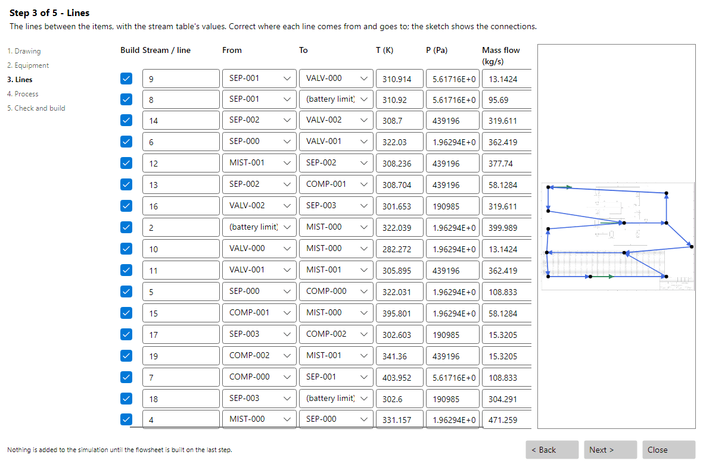
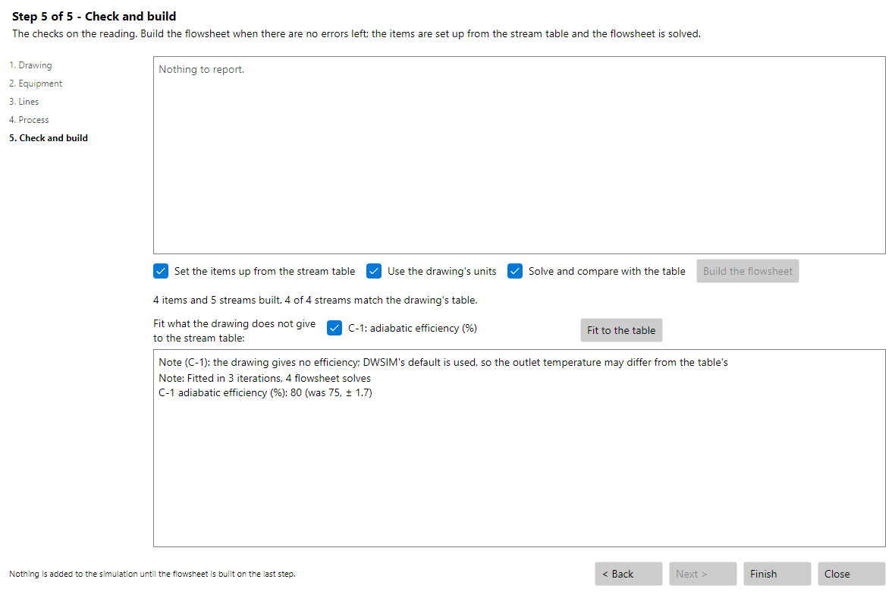
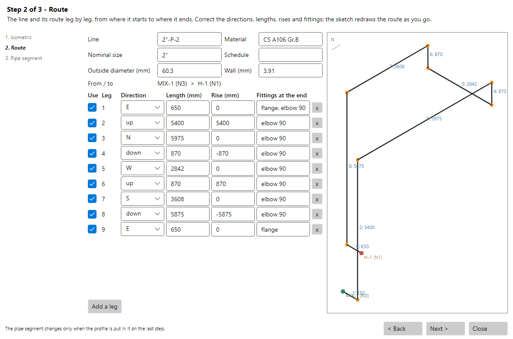
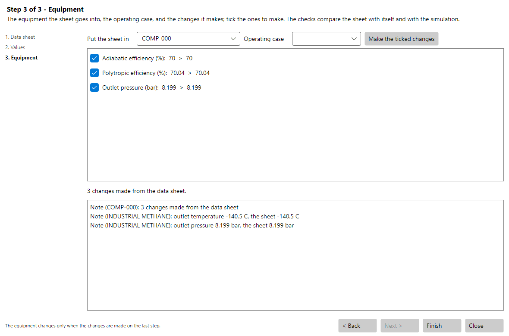

# Importing Documents with the AI Assistant

Three tools of the CAD Tools menu go the other way round: they read the documents of a plant into the simulation. Import Flowsheet from Drawing (PFD, P&ID) builds a flowsheet from a process flow diagram or a P&ID, Import Pipe Segment from Piping Isometric makes the hydraulic profile of a Pipe Segment from an isometric, and Set Equipment up from Data Sheet sets a pump, a compressor, an expander, a shell and tube exchanger, a vessel or a control valve up from its data sheet. Each runs as a wizard laid out as the Simulation Wizard, with the steps listed on the left, the same in the Classic and in the Cross-Platform interfaces, and can be stepped back and forth while the reading is corrected.

The AI Assistant reads the document: an image, a PDF, or a DXF or DWG drawing, which CADCraft plots first and whose texts DWSIM reads from the file to check the tags the model reports. The page is sent to the model as a whole and in tiles at full detail; for a data sheet in PDF the text of the page goes along with it, so the numbers are read as written. The model only reads. DWSIM checks the reading, shows it for correction and builds from it, and the reading can be saved to a file and opened again later, without reading the document a second time.

The reading needs a model that reads images (a vision model, such as Claude, GPT-4o or Gemini), chosen in the settings of the AI Assistant. The first page of each wizard says so, shows the model the AI Assistant reads with, and has a button that opens those settings: the settings window in the Classic interface, the settings page in the web browser in the Cross-Platform interface. The AI Assistant keeps the model and the API keys chosen there from one run to the next (on Windows the keys are encrypted for the user), so the choice holds even when the chat panel is not opened. When it is set to a model that runs on the computer (Ollama, LM Studio or llama.cpp), such a model seldom reads a document well: the first click on the read button stops with a note, and the button becomes Read with the local model, to read with it anyway.

While the AI Assistant reads, a moving bar beside the buttons, the step under way and the time taken so far show that it is working; a reading takes one to three minutes, and Cancel stops it at any time. When it is done, the status says which model read the document and how long it took. If the reading fails, the status gives the reason and the flowsheet log has the details.

#### Flowsheet from a PFD or P&ID

The wizard has five pages:

- **Drawing:** the file and its kind (detect, PFD or P&ID), the reading, and the drawing as the model saw it.

- **Equipment:** the items read, with their tags, the category drawn and the DWSIM object each becomes, which can be changed; a dot marks each item on the drawing. Untick an item to leave it out.

- **Lines:** each line with where it comes from and where it goes (an item or the battery limit) and the values of the stream table, drawn as arrows over the drawing.

- **Process:** the kind of process the model infers from the text of the drawing (equipment services, stream names, utilities, notes), which picks the property package from a table of processes and packages (natural gas processing takes Peng-Robinson, for instance), the compounds and the units of the drawing. Every choice can be changed here or in the Simulation Wizard, which the page opens.

- **Check and build:** the checks on the reading and the build. The checks name lines that end nowhere, items with more lines than their object has nozzles, items nothing flows into or out of, a stream table that does not balance around an item, and, for a CAD drawing, tags that are not written on it.

The build places each item where the drawing has it, makes a stream for each line on the nozzle the drawing shows (the top or bottom of a vessel or column, the side of an exchanger, the vapor or liquid outlet by the vapor fraction or the temperature of the table), adds the energy streams the items need and a recycle on each loop. With Set the items up from the stream table ticked, the feeds take their temperature, pressure, flow and composition from the table, and the items their outlet temperatures and pressures, split ratios and the keys of a shortcut column. A column with one feed and two products becomes a shortcut column; with more feeds, side draws or more products, a distillation column, or an absorption column when lines come into its top or bottom from outside (reflux, boil-up, solvent or gas), with each feed on the stage its nozzle points to and as many stages as the trays written on the drawing. The flowsheet is then solved and compared with the stream table, and the simulation name, the comments and the flowsheet metadata (the process type, its description and the key compounds, reactants and products) are filled from the drawing.

A P&ID is drawn the way it is built, and the wizard sets it straight before the checks: relief valves and the flare, drain and vent connections are left out (they carry no flow in normal operation), the fuel gas, pilot gas, combustion air and instrument air of a fired heater are left out so it keeps its process coil, an item that only burns what it takes (a gas turbine) ends its lines, and junctions where lines meet become mixers and splitters. Each of these is listed among the checks, and anything left out can be ticked to build it.

A DEXPI model can be chosen in place of a drawing: an .xml file, or several selected together, is read by the dwsim-dexpi program, without the AI Assistant, and goes through the same pages. The section DEXPI Models describes what a model gives.

The last page has, besides the build, the options that apply to the reading at hand. Update the items with the same tags, add nothing shows when the flowsheet already has items with the tags of the reading: it brings those items and their streams up to date and leaves the rest as it is, for a new revision of a drawing already imported. Pipe segments for the sized lines shows when the lines give their size in the line number (DN80-..., 6"-P-1234): it makes a Pipe Segment of each one, a straight run of 10 m with the diameters of its size. A relief valve ticked on the Equipment page is built as a Relief Valve object; a plain valve can still be chosen there.

*The lines page of the flowsheet import, with the reading of the Cavett problem drawn over the drawing.*

#### Fitting to the Stream Table (Patreon Edition)

A drawing seldom gives the efficiencies of its machines or the reflux ratio of its columns. In the Patreon Edition the last page of the flowsheet import lists what it can fit to the stream table once the flowsheet is built and solved: the adiabatic efficiency of each compressor and expander whose outlet temperature is on the table, the efficiency of each pump (offered unticked, since a pump barely warms what it moves) and the reflux ratio of each rigorous column that works to one. Fit to the table runs the data reconciliation on the temperatures, pressures and flows of the table, and on the compositions of what leaves a fitted column, with the flowsheet solved by the simultaneous solver at each point. The fitted values stay on the items, the flowsheet is solved once more, and the page reports each value, the one it replaced and its standard deviation.

*The fit of the refrigeration cycle tutorial: the compressor efficiency comes back at 80 %, the value of the original flowsheet, and all four streams match the table.*

#### Pipe Segment from a Piping Isometric

The model follows the line from its start to its end and reports each straight leg with its direction (north, south, east, west, up or down), its length and how much it rises, the fittings and valves along it, and the line number, size, outside diameter and wall, schedule, material, the start and end elevations and the bill of materials. The Route page shows the legs for correction beside an isometric sketch that redraws the route as they change. The Pipe segment page checks the route against the bill of materials (the pipe length and the number of elbows) and against the start and end elevations, lists the sections the profile gets, and puts them in the chosen Pipe Segment or in a new one named after the line:

- **Straight sections:** one for each leg, with its length and its rise, in as many increments as metres (at least five).

- **Fittings:** elbows, bends, tees, reducers and gate, globe, ball, butterfly, check and angle valves, with the same fitting in a row as one section of that quantity. Flanges, welds, supports and instruments are left out.

- **Diameters:** from the outside diameter and the wall when the isometric writes them, else from the nominal size and the schedule in the pipe table of the Pipe Segment.

- **Material:** carbon steel, stainless steel, PVC, copper or cast iron from the material or piping class, which sets the roughness.

*The route of a line of the recycle loops tutorial, read from its isometric.*

#### Equipment from a Data Sheet

The model reports every value on the sheet with its label, its unit and the standard key it stands for, the operating case it belongs to when the sheet has several columns, the side of an exchanger and the stream of a value given stream by stream. The Values page shows them for correction. The Equipment page chooses the item the sheet goes into (the one with the tag of the sheet is chosen first) and the operating case, and lists the changes, each with the value it replaces, to tick one by one:

- **Pump:** the efficiency, and the pressure rise (or the head with the density); with performance curves on the sheet, the head, efficiency, power and NPSH curves with the speed and the impeller diameter, and the pump on its curves.

- **Compressor and expander:** the adiabatic and polytropic efficiencies, the outlet pressure (or the pressure ratio) and the speed.

- **Shell and tube exchanger:** shell and tube rating with the TEMA type, the shell diameter, the tubes, their passes, pitch and layout, the baffles, the fouling and the side the hot fluid runs in; without the geometry, or as an unticked alternative, the area and the overall coefficient.

- **Vessel:** the inside diameter, the length between tangents, the heads and the orientation, with the volume and the liquid height taken from them in dynamic mode.

- **Control valve:** the rated Kv or Cv, the characteristic, and the opening: as the sheet writes it, else the one at which the valve itself, solved with its inlet, brings its outlet to the pressure on the sheet. A liquid that flashes across the valve chokes it on its flow coefficient, so such a valve keeps its pressure specification and the coefficient changes are offered unticked.

The checks compare the sheet with itself (the pressure rise against the head and the density, the shaft power against the hydraulic power and the efficiency, the area against the tubes, the duty against U, the area and the LMTD, the rated Kv against the one needed) and with the operating point of the simulation. Once the changes are made the flowsheet is solved and the outlet compared with the sheet. With the new equipment choice, a new item is made with its inlet and outlet streams named as on the sheet and the inlets set to the temperature, pressure and flow of the operating case; their composition is set by hand unless the fluid is named after one of the compounds.

*The data sheet of a compressor of the natural gas processing sample put in its compressor: the outlet matches the sheet.*

#### Limitations

- A drawing without stream data builds the topology, and the compositions and specifications are set by hand.

- Reactors are built without reactions; add the reactions and the specifications of each reactor after building.

- An exchanger put in shell and tube rating may not solve when its previous solution had the hot outlet at the cold inlet temperature, or when its hot side condenses.

